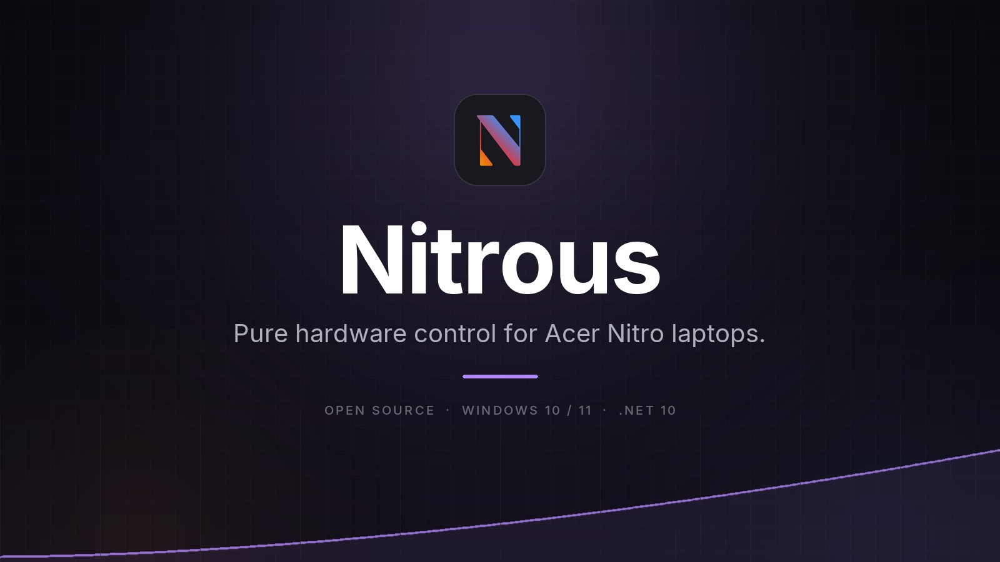
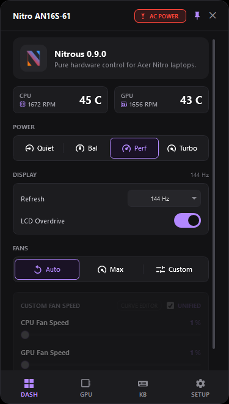
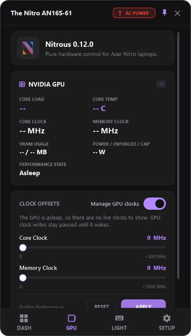
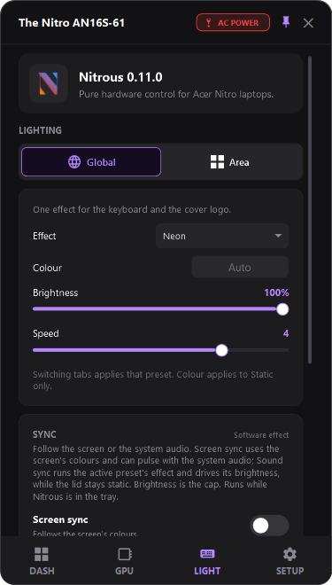
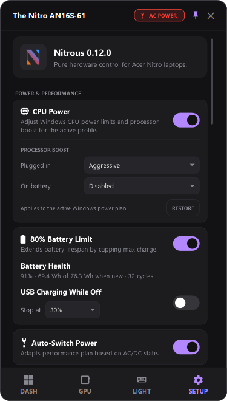

<div align="center">



### Pure hardware control for Acer Nitro laptops.
*No OEM service stack. No telemetry daemon. Just the firmware.*

[](https://github.com/jeremyaliparo/nitrous/releases/latest)
[](https://github.com/jeremyaliparo/nitrous/stargazers)
[](https://discord.gg/PGWzb3mHbG)
[](https://jeremyaliparo.github.io/nitrous/)

[**Features**](#key-features) • [**Quick Start**](#quick-start) • [**Compatibility**](#compatibility) • [**Safety & Design**](#safety--non-destructive-design) • [**Troubleshooting**](#troubleshooting) • [**Build**](#building-from-source)

<br>

<p align="center">
  <a href="assets/dashboard.png"></a>&nbsp;
  <a href="assets/gpu.png"></a>&nbsp;
  <a href="assets/keyboard.png"></a>&nbsp;
  <a href="assets/settings.png"></a>
</p>

</div>

---

## Why Nitrous?

OEM control centers install heavy background service stacks, telemetry daemons, and wake your discrete GPU just to read a temperature sensor. **Nitrous** replaces all of it with a single portable executable:

- **Zero Idle dGPU Wake:** GPU telemetry is only polled while the GPU tab is actively open, and sleeping (`D3`) GPUs are checked via free Windows PnP state queries so battery life is never tanked.
- **Reversible Changes:** CPU power limits, processor boost mode, and disabled Acer services are backed up before they are touched and restored with one click.
- **Portable & Lightweight:** Ships as a single framework-dependent `.exe` with silent tray boot, configurable global hotkeys, and SHA-256 verified updates.

---

## Key Features

| Subsystem | Capabilities |
| :--- | :--- |
| **Cooling** | • **Granular Fan Control:** Per-profile custom fan curves, manual control (**1% to 100%**), Auto, and Max.<br>• **Ramp Shaping:** Fans spin up instantly under load but step down gradually so short CPU bursts don't cause annoying revving.<br>• **CoolBoost:** where the firmware has it, one switch raises its own fan speeds - shown in Auto and Custom, hidden in Max, which is already full speed. |
| **Power & EC** | • **Firmware Profiles:** Quiet, Balanced, Performance, and Turbo applied directly through the EC so enforced GPU power limits follow.<br>• **CPU Tuning:** Per-profile CPU min/max limits and processor boost modes with automatic baseline backup and restore.<br>• **Battery Health:** Battery charge limiter and USB power delivery while the laptop is powered off.<br>• **AC/DC Memory:** Optional separate power and fan modes for AC and battery, applied when the charger changes. |
| **GPU** | • **Clock Offsets:** Core and memory frequency offsets with live clocks, utilization, and thermal readouts.<br>• **Opt-In Ownership:** Clock writes are **off by default** so external tools (like MSI Afterburner) are never overwritten unexpectedly. When enabled, a background watchdog automatically repairs driver clock drift. |
| **Display** | • **Dynamic Refresh Rate:** Switch to any refresh rate the panel advertises. `Auto` uses your chosen rate on AC and 60 Hz on battery.<br>• **LCD Overdrive:** Panel response overdrive where the display reports support for it. |
| **Lighting** | • **TOTAL LIGHTNING CONTROL:** Global and Area presets — four per-zone colours or one effect across all zones, with brightness and speed, driven through the keyboard's own HID controller.<br>• **Screen & Sound Sync:** Follow the screen's colours, run the active effect on the audio, or combine screen colours with an audio beat - with four-band Spectrum, bass Beat, the Vibe five-step engine, saturation and a silence floor.<br>• **Cover Logo:** The lid logo is driven too, with Static, Breathing and Neon effects and five speed steps.<br>• **Mode Flash:** The keyboard acknowledges a power-profile change in the mode's colour, as the OEM software does.<br>• **Fit to Hardware:** Single-colour keyboards get one Colour chip instead of four dead zones, and a model with no reachable controller gets no LIGHT tab at all. |
| **Appearance** | • **Accent:** Seven curated colours, `Auto` (follow Windows), or any custom colour - contrast-checked so a pick cannot make a label unreadable.<br>• **Backgrounds:** Five window presets - Midnight, Black, Graphite, Slate and Navy - each rebuilding the card, hover, border and toggle shades around the window colour.<br>• **Sections:** The card surface set on its own, so panels can stay grey on a black window or go darker still, with the edges derived from the chosen colour.<br>• **Font:** The UI font is picked from the families your PC actually has, code faces included; a font that is not installed is never offered, so a choice always applies. |
| **System & App** | • **OEM Service Disabler:** One-click disable (and exact restore) of stock Acer background services.<br>• **Hardware Diagnostics:** Built-in redacted diagnostic bundler and read-only EC probe for comparing unsupported Nitro models. |

---

## Quick Start

### 1. Check Requirements

| Component | Requirement |
| :--- | :--- |
| **OS** | Windows 10 or Windows 11 (x64) |
| **Runtime** | [**.NET 10 Desktop Runtime (x64)**](https://dotnet.microsoft.com/download/dotnet/10.0) *(Required — the app will not start without it)* |
| **Privileges** | Administrator (requested automatically via app manifest) |
| **Hardware** | Acer Nitro laptop with the gaming WMI interface (probed at startup; 2019 models confirmed) |

### 2. Download & Verify

Nitrous is completely portable and requires no installer.

1. Download `Nitrous.exe` and `SHA256SUMS` from the [**Releases**](https://github.com/jeremyaliparo/nitrous/releases) page.
2. *(Recommended)* Verify the executable checksum in PowerShell against `SHA256SUMS` or `Nitrous.exe.sha256`:
   ```powershell
   Get-FileHash .\Nitrous.exe -Algorithm SHA256
   ```
3. Move `Nitrous.exe` to a permanent folder (e.g., `C:\Tools\Nitrous`) and launch it.

> [!TIP]
> Nitrous runs silently in your system tray. Click the tray icon or press your dashboard hotkey (**Ctrl + Home** by default, rebindable on the Setup page) to summon the dashboard. Configure AC/battery automation rules under **Setup**.

---

## Compatibility

Designed for Acer Nitro laptops that expose the gaming WMI classes and, on some models, an embedded-controller HID interface. The year does not decide it: a 2019 AN517-51 runs Nitrous the same way a 2025 16S does, and a feature the firmware does not answer simply stays hidden.

**Confirmed Models:**
- **Acer Nitro 5** (`AN517-51`, 2019)
- **Acer Nitro 16S** (`AN16S-61`)
- **Acer Nitro V 15** (`ANV15-41`<!--, `ANV15-52` — *Thanks [@Baymax0251](https://github.com/Baymax0251) for testing!* -->)

> [!NOTE]
> **Unlisted models work out of the box** if they follow the same Acer protocol—nothing is hardcoded to a model string. Nitrous inspects your SMBIOS tables, available WMI methods, and EC HID interfaces at startup, enabling every control your firmware supports and disabling or hiding what it doesn't. If a feature is greyed out on your machine, run **Setup → Diagnostics → EC PROBE** and open an issue.

---

## Safety & Non-Destructive Design

> [!CAUTION]
> Nitrous writes directly to your Embedded Controller (EC) firmware and GPU driver. It is an unofficial project not affiliated with Acer—use it at your own risk.

Nitrous is engineered so that every system change is clamped, isolated, or backed up before a single byte is written:

- **Hard Fan Floor (1%):** Manual speeds and custom curves are strictly clamped to a minimum of **1%** in both the UI and the WMI layer so stale registry values can never zero-out your fans.
- **CPU Limit Backups:** Original AC/DC min/max processor states are backed up in `HKCU\Software\Nitrous` (`CpuPowerBackup_<scheme>_{AC|DC}_{Min|Max}`) and restored on exit or recovery from an abrupt crash. Do not delete these keys while CPU limits are active.
- **Processor Boost Backups:** Backed up under `CpuBoostBackup_<scheme>_{AC|DC}`. Since boost mode is a persistent preference, it stays active across reboots—use **Setup → Processor Boost Mode → RESTORE** to revert to Windows defaults.
- **Acer Service Snapshots:** Disabling OEM services is strictly opt-in. Before stopping anything, Nitrous snapshots the exact start types, delayed-auto flags, and running states to `%LOCALAPPDATA%\Nitrous\acer-services-backup.json`. Use **Setup → Acer Background Services → RESTORE** to revert. *(Note: Services already disabled prior to using Nitrous have no baseline and will not be touched).*
- **Opt-In GPU Clock Ownership:** **Nitrous manages GPU clocks** is **OFF by default** (including across updates).
  - *When OFF:* Nitrous is strictly read-only. Startup, profile switches, hotkeys, AC/DC transitions, resume, the 30-second watchdog, APPLY, and RESET perform zero GPU writes. Turning the switch off never writes on its own, though it will offer to clear offsets previously applied by Nitrous.
  - *When ON:* Saved per-profile P0 core/memory deltas (`0/0` = stock) are applied, verified, and maintained by the watchdog. Because Nitrous writes only P0 clock deltas and never voltage, it cannot preserve an external MSI Afterburner voltage/frequency curve—**run only one clock manager at a time**.
- **Honest Battery Telemetry:** The wattage indicator next to the power pill shows the live Windows battery charge/discharge rate, never a fabricated adapter wattage rating.

---

## Troubleshooting

<details>
<summary><b>GPU offsets keep resetting to 0</b></summary>

- Ensure the background tray process is running (the clock watchdog lives in the tray process).
- Verify **Nitrous manages GPU clocks** is turned **ON** on the GPU page.
- Check `%LOCALAPPDATA%\Nitrous\logs\nitrous.log` for `GPU OC`, `NVAPI`, or `NVML` warnings. Every write logs its trigger (`startup`, `profile-click`, `hotkey`, `acdc`, `watchdog`, `apply`, `reset`) along with old and new offsets.
- **Note on sleeping GPUs:** A dGPU in `D3` sleep cannot be read or written. Nitrous checks the Windows PnP power state without waking the card and skips polling until the GPU wakes up, preventing false `0` overwrites.
- If another utility resets the P0 state, the Nitrous watchdog repairs it within 30 seconds.
</details>

<details>
<summary><b>MSI Afterburner sliders or mV curve reset when Nitrous starts</b></summary>

- Nitrous and Afterburner must not manage clocks simultaneously. Either turn **Nitrous manages GPU clocks** **OFF** in Nitrous, or zero out Afterburner's Core/Memory sliders and let Nitrous handle per-profile offsets.
- Nitrous writes a sparse P0 packet with `0` base-voltage entries, which replaces the driver's active P0 override and drops custom voltage/frequency curves.
- If an external voltage curve is present, `gpu.json` and the log flag `voltageOverridesDetected` to aid bug reporting.
</details>

<details>
<summary><b>Fans are not following my custom curve</b></summary>

- Custom curves only execute when the fan mode is set to **Custom/Medium** and curve mode is toggled on.
- Confirm Nitrous is running with Administrator privileges and your laptop exposes `AcerGamingFunction`.
- Check the log for WMI write failures; if a write fails, the engine automatically retries on the next 2-second tick.
</details>

<details>
<summary><b>Acer hotkeys or lighting stopped working</b></summary>

- Open **Setup → Acer Background Services** and click **RESTORE** to re-enable and restart the OEM services.
- If the status shows *already disabled; no Nitrous backup to restore*, the services were disabled outside of Nitrous—re-enable them via Windows Services (`services.msc`).
- If a restore is only partially successful, `%LOCALAPPDATA%\Nitrous\acer-services-backup.json` is retained so you can retry.
</details>

<details>
<summary><b>CPU min/max values look wrong or Boost Mode names differ</b></summary>

- **CPU Min/Max:** Nitrous restores the exact baseline captured before it modified your power scheme (not a hardcoded `5%/100%`). To reset manually, toggle the CPU power feature off, wait for the log confirmation, and exit Nitrous.
- **Boost Modes:** Available modes are queried directly from the active Windows power plan and system firmware, falling back to standard documented modes if Windows exposes none. Click **RESTORE** to return to your original AC/DC boost settings.
</details>

<details>
<summary><b>A control is greyed out / disabled</b></summary>

Nitrous disables controls when your firmware does not respond to them rather than failing silently. Hover over any disabled control to see the exact reason:
- **Keyboard Zones:** Requires a 4-zone RGB keyboard; single-colour models get one Colour chip instead.
- **LIGHT page:** A model with no reachable keyboard-lighting controller gets no tab at all. Its Fn keys may still change the backlight, but no user-mode interface exposes that.
- **Cover Logo:** Confirmed once with a test colour on the first visit. If the lid's "N" did not light up, the effect controls are replaced by an explanation and nothing further is written to that device.
- **Keyboard Auto-Off:** Requires the embedded-controller interface and now lives in **Setup → KEYBOARD**. On models without it Nitrous cannot reach the setting, even where the OEM software still offers it.
- **USB Charging While Off:** Requires an Acer WMI class that is only partially implemented on certain BIOS versions.
- **CoolBoost:** Offered only where the firmware itself says APGeAction function 7 is CoolBoost. On firmware that uses that function for the power mode the switch stays hidden, because writing it would change the mode.

**LCD Overdrive** is the exception: it is a panel property, so where the display reports no support the control is hidden entirely rather than greyed out, and the refresh list fills the row.
</details>

<details>
<summary><b>Auto-update says "manual download required"</b></summary>

- The release did not publish a GitHub asset digest or checksum file. Visit the Releases page and download the update manually after checking the hash.
</details>

### Reporting Bugs & Diagnostics

If you encounter a bug or unsupported hardware control, attach a diagnostic bundle to your GitHub issue:

1. Open **Setup → Diagnostics** and click **Export Diagnostics**.
2. Nitrous saves a redacted ZIP to `%LOCALAPPDATA%\Nitrous\diagnostics` and highlights it in File Explorer.
3. Attach `Nitrous-Diagnostics-*.zip` to your issue.

> [!NOTE]
> **Privacy First:** Nothing is uploaded automatically. Usernames, machine names, user-profile paths, SIDs, emails, and IP/MAC addresses are scrubbed before the ZIP is created, and BIOS, motherboard and memory serial numbers plus system UUIDs are never collected at all. You can inspect `summary.txt` and `errors.txt` inside the archive before sharing.

### File & Registry Locations

| Path | Description |
| :--- | :--- |
| `%LOCALAPPDATA%\Nitrous\logs\nitrous.log` | Application logs (rotated at 1 MB, up to 3 archives; tagged by process role and PID). |
| `%LOCALAPPDATA%\Nitrous\diagnostics` | Exported diagnostic ZIP bundles. |
| `%LOCALAPPDATA%\Nitrous\acer-services-backup.json` | Snapshot of original Acer service start types and running states. |
| `HKCU\Software\Nitrous` | User preferences plus CPU power and boost baseline backups. |

---

## Building From Source

Requires the **.NET SDK 10.0.400** or newer on Windows (pinned via `global.json` with `rollForward: latestFeature`).

```powershell
# Restore and build Release
dotnet restore app/Nitrous.csproj
dotnet build app/Nitrous.csproj -c Release

# Publish a framework-dependent single-file executable
dotnet publish app/Nitrous.csproj `
  -c Release `
  -r win-x64 `
  --self-contained false `
  -p:PublishSingleFile=true `
  -p:DebugType=none `
  -p:DebugSymbols=false `
  -o dist
```

Visual Studio users can also publish directly using `app/Properties/PublishProfiles/win-x64.pubxml`.

<details>
<summary><b>Release Architecture & Auto-Updater Verification</b></summary>

> [!WARNING]
> `Nitrous.exe` is **not code-signed**. Always download from official GitHub Releases and verify the SHA-256 hash.

The release workflow supports both `MAJOR.MINOR.PATCH` and `vMAJOR.MINOR.PATCH` tags (numeric tags are used starting with `0.8.1` for backward compatibility with `0.7.2`'s `Version.TryParse` updater) and publishes `Nitrous.exe`, `SHA256SUMS`, and `Nitrous.exe.sha256`.

Before replacing the executable during an auto-update, Nitrous enforces a strict verification pipeline:
1. Queries the latest GitHub release for a `sha256:<hex>` asset digest.
2. Falls back to downloading and parsing `Nitrous.exe.sha256` or `SHA256SUMS` from the release assets.
3. Refuses the automatic update and prompts for manual download if neither checksum source is present.
4. Validates that the downloaded binary is a valid PE image, matches a plausible file size, and passes the SHA-256 check before renaming the active binary to `Nitrous.exe.old` and spawning the updated process with `--updated` (rolling back automatically if replacement fails).
</details>

---

<div align="center">
<sub>Unofficial open-source utility. Not affiliated with or endorsed by Acer Inc. Use at your own risk.</sub>
</div>
