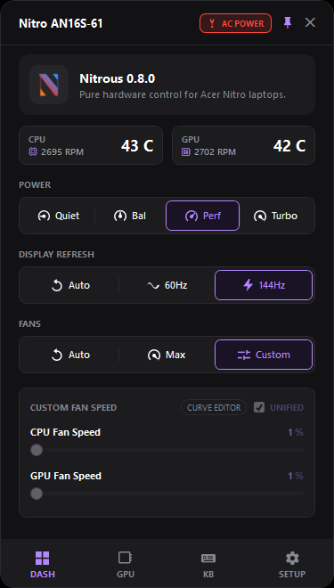
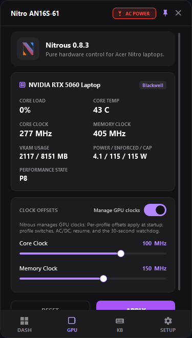
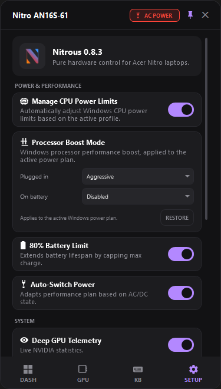

<div align="center">


# Nitrous

**Pure, zero-bloat hardware control for Acer Nitro laptops.**

<p align="center">
  
  
  
</p>

---

</div>

Nitrous bypasses heavy, bloated OEM telemetry services by communicating directly with your Acer Nitro's Embedded Controller (EC) via WMI. It gives you an ultra-fast, lightweight dashboard for raw, instant hardware control.

### Key Features
* **Custom Fan Curves:** Per-profile fan curves with overridable defaults, plus manual control from **1% to 100%**, Auto, and Max modes. The 1% floor is enforced in the UI, the curve editor, curve storage, interpolation, and again at the WMI boundary. Low fan speeds reduce cooling, so use them with care.
* **Optimized NVML Telemetry:** Direct `nvml.dll` integration instead of `nvidia-smi.exe` for high-performance telemetry with low CPU overhead. Deep telemetry can be disabled for older NVIDIA GPUs.
* **Dedicated GPU OC/UC Tab:** Fine-tune core and memory offsets with real-time telemetry, clock speeds, usage, and thermal tracking. Offsets are validated against the driver's advertised range and verified after applying.
* **Persistent GPU OC:** A background watchdog re-reads the applied P0 offsets and repairs drift every 30 seconds, after sleep/resume, and after a driver reset. A failed read (for example, a sleeping dGPU) is never treated as "0 MHz".
* **Auto-Apply OC Profiles:** Re-applies saved custom GPU offsets for the active power profile, with a longer retry window at boot. Built-in profile defaults are stock `0/0`, so overclocking is opt-in.
* **CPU Power Management:** Per-profile CPU min/max power states with **backup and exact restore**. The original AC and DC values are captured per power scheme before the first write, changes are serialized across the tray and dashboard processes, and the originals are restored when the feature is disabled or the app exits. Correct write ordering prevents `min > max` during dead-band changes.
* **Dedicated Keyboard Tab & Hotkeys:** Customizable shortcuts for cycling power profiles and opening the dashboard. Hotkey edits are picked up by the tray engine without a restart.
* **Smart Automation:** Apply quiet modes and 60 Hz refresh on battery, then restore performance and the high refresh rate on AC power.
* **Battery Protection:** Hardware-level charge limit to extend battery lifespan; re-asserted after resume.
* **Dynamic Power Profiles:** Toggle instantly between Quiet, Balanced, Performance, and Turbo TDP modes.
* **Silent Boot & System Tray:** Starts through Task Scheduler without a UAC prompt on every boot, with restart support in the tray menu.
* **Verified Auto-Updater:** Downloads GitHub release assets and verifies a SHA-256 digest before installing. If a release does not publish a digest or checksum, the updater refuses the automatic install and offers the release page instead.
* **Diagnostics:** Hardware, power-plan, update, and startup failures are written to a rotating log, and **Settings → Diagnostics → Export Diagnostics** creates a redacted ZIP with the system, hardware, and log context needed for a bug report.

### Requirements

* Windows 10 or Windows 11, x64.
* An Acer Nitro model that exposes the `AcerGamingFunction` WMI interface (see **Compatibility**).
* Administrator privileges. The app manifest requests elevation.
* The release build is framework-dependent, so install the [.NET 10 Desktop Runtime (x64)](https://dotnet.microsoft.com/download/dotnet/10.0) first. The published `Nitrous.exe` is a single file, but it still needs the shared runtime.

### Quick Start

Nitrous is a portable application with no setup wizard.

1. Install the **.NET 10 Desktop Runtime (x64)** if it is not already present.
2. Download `Nitrous.exe` and `SHA256SUMS` from [Releases](https://github.com/jeremyaliparo/nitrous/releases).
3. Verify the download (recommended):

   ```powershell
   Get-FileHash .\Nitrous.exe -Algorithm SHA256
   ```

   The hash must match the one in `SHA256SUMS` (or `Nitrous.exe.sha256`).
4. Save `Nitrous.exe` anywhere on your PC (for example, `C:\Tools`) and launch it. Accept the UAC prompt.

> **Usage:** Nitrous runs silently in the System Tray. Click the tray icon or press your keyboard's dedicated Nitro key to open the dashboard. Configure automation rules in the **Settings** menu.

### Building From Source

Prerequisites: .NET SDK **10.0.400** or newer (pinned by `global.json` with `rollForward: latestFeature`) on Windows.

```powershell
dotnet restore app/Nitrous.csproj
dotnet build app/Nitrous.csproj -c Release
```

Build a framework-dependent single-file executable:

```powershell
dotnet publish app/Nitrous.csproj `
  -c Release `
  -r win-x64 `
  --self-contained false `
  -p:PublishSingleFile=true `
  -p:DebugType=none `
  -p:DebugSymbols=false `
  -o dist
```

Visual Studio users can use the checked-in profile at `app/Properties/PublishProfiles/win-x64.pubxml`.

### Releases and Update Verification

The release workflow runs on tags matching `vMAJOR.MINOR.PATCH` and publishes:

* `Nitrous.exe` — framework-dependent single-file executable.
* `SHA256SUMS` — standard checksum line for the executable.
* `Nitrous.exe.sha256` — the same checksum in a single-file form.

The executable is **not code-signed**. The updater therefore verifies integrity before replacing anything:

1. It reads the latest GitHub release and looks for a GitHub asset `digest` of the form `sha256:<hex>`.
2. If the digest is absent, it downloads `Nitrous.exe.sha256` or `SHA256SUMS` from the same release and parses the SHA-256 value.
3. If neither is available, it refuses the automatic update and directs the user to the release page for a manual download.
4. The downloaded file must be a PE image, have a plausible size, and match the checksum. The running executable is renamed to `Nitrous.exe.old`, the new file is copied into place, and the new process is started with `--updated` so it waits for the old process to release the single-instance mutex. If replacement fails, the old executable is restored.

Checksums protect against a corrupted or tampered download; they are not a substitute for code signing. Only download from the official repository and verify the published hash.

### Safety Notes

* **Fan floor:** Manual speeds and curves are clamped to **1%**. The UI slider and curve editor enforce it, and the WMI layer clamps again so stale registry values cannot bypass it.
* **CPU limits:** Original AC/DC min/max values are backed up under `HKCU\Software\Nitrous` as `CpuPowerBackup_<scheme>_{AC|DC}_{Min|Max}`. They are restored when the feature is turned off or the app exits. If the app is terminated abruptly, the backups remain and are restored on the next run. Do not delete these values while the feature is enabled unless you intend to lose the original defaults.
* **GPU offsets:** Built-in profile defaults are stock `0/0`; positive and negative offsets are applied only after the user chooses them. Values are checked against the driver's advertised range and read back after applying. The watchdog only re-applies after a successful read, so it does not wake a sleeping dGPU just to compare offsets. A stock `0/0` profile is treated as "no override" during automatic startup, resume, AC/DC switching, and watchdog repairs, so it will not wipe an offset applied manually or by another tool; selecting the profile or pressing **APPLY**/**RESET** still writes the saved values explicitly. Exact legacy automatic-offset values are migrated to `0/0` on first run.
* **Unsupported hardware:** Nitrous refuses to start on machines that do not expose the required Acer WMI class.

### Troubleshooting

**The GPU offsets still reset to 0**

* Make sure the tray process is running; the watchdog lives there.
* Check `%LOCALAPPDATA%\Nitrous\logs\nitrous.log` for `NVAPI`, `GPU OC`, or `NVML` warnings.
* A sleeping dGPU cannot be read or written. The watchdog waits for the next successful read instead of overwriting the saved offsets with 0.
* If another overclocking tool clears the P0 performance state, Nitrous should repair it within 30 seconds.

**CPU min/max values look wrong**

* The app restores the exact values captured before it first changed the scheme, not a hard-coded `5/100`.
* Check the log for `CPU power:` entries. If a restore could not complete, the backup values are retained and a later run will retry.
* If you need to reset manually, turn the CPU power feature off, wait for the log entry, then exit Nitrous.

**Fans are not following the curve**

* Custom curves only run while the fan mode is **Custom/Medium** and curve mode is enabled.
* The log records WMI failures; the engine retries on the next 2-second tick rather than marking a failed write as applied.
* Ensure the process is elevated and the model exposes `AcerGamingFunction`.

**An update says "manual download required"**

* That release did not publish a GitHub asset digest or a checksum asset. Open the release page and update manually after verifying the hash.

**Sending a diagnostics bundle**

If you are reporting a bug, attach a diagnostics bundle to the issue:

1. Open **Settings → Diagnostics** and click **Export Diagnostics**.
2. Nitrous writes a ZIP to `%LOCALAPPDATA%\Nitrous\diagnostics` and opens it in Explorer.
3. After creating the issue, attach the newest `Nitrous-Diagnostics-*.zip` in a comment.

The bundle includes the Nitrous version, Windows build, laptop model/BIOS, CPU/RAM/GPU details, Acer WMI availability and sensor probes, current GPU offset and driver ranges, CPU power limits and backups, display mode, startup task, updater state, recent redacted logs, and bounded excerpts from the System and Application event logs. Nothing is uploaded automatically.

The current username, machine name, serial numbers, system UUIDs, user-profile paths, SIDs, email addresses, and IP/MAC addresses are redacted before the ZIP is written. You can inspect the ZIP before sharing it; `summary.txt` is the best place to start, and `errors.txt` lists any sections that could not be collected.

**Logs and settings**

* Log: `%LOCALAPPDATA%\Nitrous\logs\nitrous.log` (rotated at 1 MB, up to 3 older files). Each line includes the process role and PID so tray and dashboard entries can be told apart.
* Diagnostics: `%LOCALAPPDATA%\Nitrous\diagnostics`.
* Settings: `HKCU\Software\Nitrous`.

### Compatibility

Designed for modern Acer Nitro laptops (2021+) using `AcerGamingFunction` WMI classes.

**Confirmed Models:**
* Acer Nitro 16S (`AN16S-61`)
* Acer Nitro V 15 (`ANV15-41`<!--, `ANV15-52` — *Thanks [@Baymax0251](https://github.com/Baymax0251) for testing!* -->)

---

*Disclaimer: Unofficial open-source utility. Not affiliated with Acer. Use at your own risk.*
